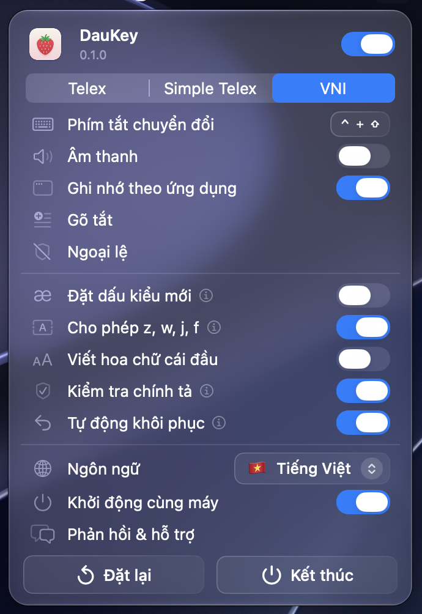

<p align="center">
  
</p>

<h1 align="center">DauKey</h1>

<p align="center">An open-source Vietnamese input method for macOS, without preedit.</p>

<p align="center">
  
</p>

Yes, it's another Vietnamese input method, true to the old joke "phấn đấu mỗi người một bộ gõ". I knew the joke long before I started this project, and it does sting a little, but I'm not building DauKey to show off in any group. I'm building it to solve my own problem, and maybe it helps someone who has the same one.

I got fed up with OpenKey stopping Vietnamese input altogether whenever I mistyped a word. The typo is my fault, but that's no reason for the engine to stop working, and OpenKey's last release was a long time ago. Gõkey ships its app unsigned and unnotarized, and in my experience it's just as buggy. EVKey and GoTiengViet are entirely closed source, and I don't want a closed-source input method. The one built into macOS uses preedit, the underlined composing text, which I hated most back when I used a Linux desktop.

DauKey's engine is written from scratch, so don't expect it to behave like UniKey or OpenKey. It's made for the Mac only, with no plans to reuse it on other platforms:

- There will be no Windows version. I use UniKey on Windows and have no problems with it.
- A Linux version is uncertain, at least for the near future. If there ever is one, it will be a completely separate project, and it will not use preedit.

DauKey never opens a network connection: no auto-update, not even a check for new versions.

I use DauKey every day. If you run into a problem, please [open an issue](https://github.com/emizuki/daukey/issues) and I'll try to fix it as fast as I can.

I knew building an input method would be hard, but I only found out how hard once I started.

## Install

Requires macOS 26 or later on Apple Silicon.

1. Download `DauKey-x.y.z.zip` from [Releases](https://github.com/emizuki/daukey/releases), unzip it, and move `DauKey.app` to Applications.
2. Open DauKey, allow Accessibility so it can receive keystrokes, then select an input method.

DauKey lives in the menu bar. Press ⌃⇧ to switch between Vietnamese and English.

## Build

Requires Xcode; the Command Line Tools are not enough, because the icon is compiled with `actool`.

```sh
scripts/make-signing-cert.sh   # once: a "DauKey Local" certificate keeps the Accessibility grant across rebuilds
scripts/bundle.sh --install    # build, sign and install to /Applications
swift test -c release          # run the tests
```

To skip the certificate, sign ad hoc with `DAUKEY_SIGN_IDENTITY=- scripts/bundle.sh`, but then Accessibility has to be granted again after every rebuild.

## License

[GPL-3.0](LICENSE)
